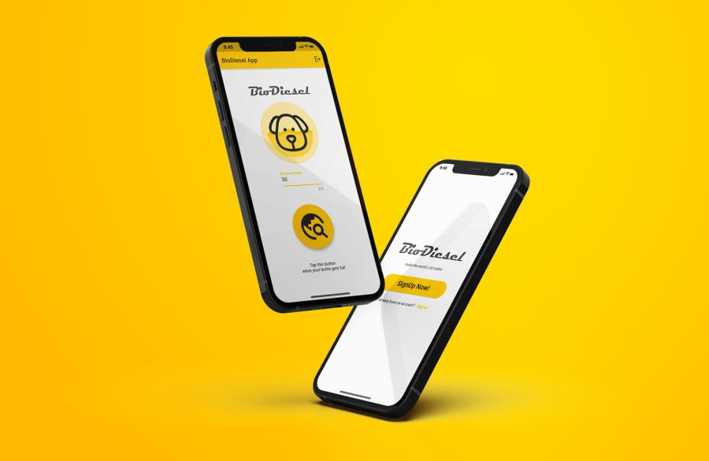

# Biodiesel App Prototype

A Flutter UI prototype for a service that would collect used cooking oil for recycling. It explores the sign-up and hand-off experience through forms and custom animations. Its screens simulate the workflow without a collection or account backend.



[Animated oil percentage indicator in the Biodiesel prototype](docs/images/oil-percentage-animation.gif)

## Explore the code

Start with the [home screen](lib/user_home_screen.dart), [sign-up form](lib/sign_up_form.dart), and [animated mascot](lib/animal.dart).

## Run locally

Use a Flutter SDK that satisfies the Dart 2 constraint in [`pubspec.yaml`](pubspec.yaml).

```sh
flutter pub get
flutter run
```
